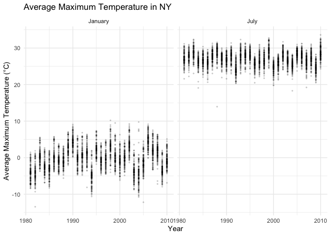
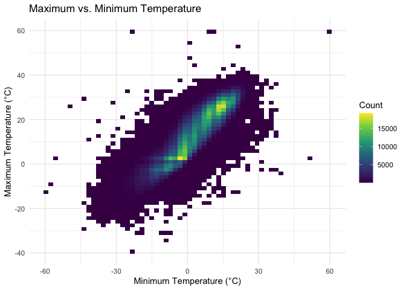
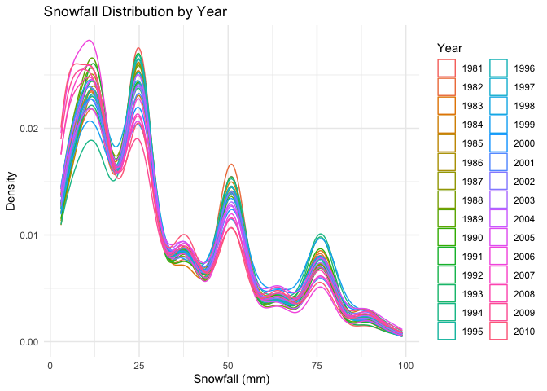

P8105 Homework 3
================
Your Name

# Problem 1

``` r
data("ny_noaa")

head(ny_noaa)
```

    ## # A tibble: 6 × 7
    ##   id          date        prcp  snow  snwd tmax  tmin 
    ##   <chr>       <date>     <int> <int> <int> <chr> <chr>
    ## 1 US1NYAB0001 2007-11-01    NA    NA    NA <NA>  <NA> 
    ## 2 US1NYAB0001 2007-11-02    NA    NA    NA <NA>  <NA> 
    ## 3 US1NYAB0001 2007-11-03    NA    NA    NA <NA>  <NA> 
    ## 4 US1NYAB0001 2007-11-04    NA    NA    NA <NA>  <NA> 
    ## 5 US1NYAB0001 2007-11-05    NA    NA    NA <NA>  <NA> 
    ## 6 US1NYAB0001 2007-11-06    NA    NA    NA <NA>  <NA>

``` r
dim(ny_noaa)
```

    ## [1] 2595176       7

``` r
str(ny_noaa)
```

    ## tibble [2,595,176 × 7] (S3: tbl_df/tbl/data.frame)
    ##  $ id  : chr [1:2595176] "US1NYAB0001" "US1NYAB0001" "US1NYAB0001" "US1NYAB0001" ...
    ##  $ date: Date[1:2595176], format: "2007-11-01" "2007-11-02" ...
    ##  $ prcp: int [1:2595176] NA NA NA NA NA NA NA NA NA NA ...
    ##  $ snow: int [1:2595176] NA NA NA NA NA NA NA NA NA NA ...
    ##  $ snwd: int [1:2595176] NA NA NA NA NA NA NA NA NA NA ...
    ##  $ tmax: chr [1:2595176] NA NA NA NA ...
    ##  $ tmin: chr [1:2595176] NA NA NA NA ...
    ##  - attr(*, "spec")=
    ##   .. cols(
    ##   ..   id = col_character(),
    ##   ..   date = col_date(format = ""),
    ##   ..   prcp = col_integer(),
    ##   ..   snow = col_integer(),
    ##   ..   snwd = col_integer(),
    ##   ..   tmax = col_character(),
    ##   ..   tmin = col_character()
    ##   .. )

``` r
noaa_clean = ny_noaa |>
  mutate(
    year = year(date),
    month = month(date),
    day = day(date),
    tmax = as.numeric(tmax) / 10,
    tmin = as.numeric(tmin) / 10,
    prcp = prcp / 10
  )

head(noaa_clean)
```

    ## # A tibble: 6 × 10
    ##   id          date        prcp  snow  snwd  tmax  tmin  year month   day
    ##   <chr>       <date>     <dbl> <int> <int> <dbl> <dbl> <dbl> <dbl> <int>
    ## 1 US1NYAB0001 2007-11-01    NA    NA    NA    NA    NA  2007    11     1
    ## 2 US1NYAB0001 2007-11-02    NA    NA    NA    NA    NA  2007    11     2
    ## 3 US1NYAB0001 2007-11-03    NA    NA    NA    NA    NA  2007    11     3
    ## 4 US1NYAB0001 2007-11-04    NA    NA    NA    NA    NA  2007    11     4
    ## 5 US1NYAB0001 2007-11-05    NA    NA    NA    NA    NA  2007    11     5
    ## 6 US1NYAB0001 2007-11-06    NA    NA    NA    NA    NA  2007    11     6

``` r
noaa_clean |>
  summarise(
    across(
      everything(),
      ~ sum(is.na(.x))
    )
  )
```

    ## # A tibble: 1 × 10
    ##      id  date   prcp   snow   snwd    tmax    tmin  year month   day
    ##   <int> <int>  <int>  <int>  <int>   <int>   <int> <int> <int> <int>
    ## 1     0     0 145838 381221 591786 1134358 1134420     0     0     0

``` r
noaa_clean |>
  count(snow, sort = TRUE) |>
  head(10)
```

    ## # A tibble: 10 × 2
    ##     snow       n
    ##    <int>   <int>
    ##  1     0 2008508
    ##  2    NA  381221
    ##  3    25   31022
    ##  4    13   23095
    ##  5    51   18274
    ##  6    76   10173
    ##  7     8    9962
    ##  8     5    9748
    ##  9    38    9197
    ## 10     3    8790

### NOAA Data Description

The NOAA dataset contains 2,595,176 observations and 7 original
variables, including station ID, date, precipitation, snowfall, snow
depth, and maximum and minimum temperatures.

The data were cleaned by separating the date into year, month, and day,
converting temperatures to degrees Celsius, and converting precipitation
to millimeters.

Missing data are common, especially for maximum and minimum
temperatures, each with over 1.13 million missing observations.

The most common snowfall value is 0 mm (2,008,508 observations),
followed by missing values (381,221). This is expected because most days
have no snowfall, and some weather stations do not report snowfall
measurements.

``` r
jan_jul_temp = noaa_clean |>
  filter(month %in% c(1, 7)) |>
  group_by(id, year, month) |>
  summarise(
    mean_tmax = mean(tmax, na.rm = TRUE),
    .groups = "drop"
  ) |>
  filter(is.finite(mean_tmax)) |>
  mutate(
    month = factor(
      month,
      levels = c(1, 7),
      labels = c("January", "July")
    )
  )

ggplot(
  jan_jul_temp,
  aes(x = year, y = mean_tmax, group = id)
) +
  geom_point(alpha = 0.15, size = 0.5) +
  facet_grid(. ~ month) +
  labs(
    title = "Average Maximum Temperature in NY",
    x = "Year",
    y = "Average Maximum Temperature (°C)"
  ) +
  theme_minimal()
```

<!-- --> January
temperatures are much lower and more variable than July temperatures.
January averages range mostly from -10°C to 10°C, while July averages
are generally between 20°C and 33°C. There are some unusually low values
in both months, but no clear long-term warming or cooling trend is
visible from this plot.

``` r
# Temperature relationship
temp_plot = noaa_clean |>
  filter(!is.na(tmax), !is.na(tmin)) |>
  ggplot(aes(x = tmin, y = tmax)) +
  geom_bin2d(bins = 60) +
  scale_fill_viridis_c() +
  labs(
    title = "Maximum vs. Minimum Temperature",
    x = "Minimum Temperature (°C)",
    y = "Maximum Temperature (°C)",
    fill = "Count"
  ) +
  theme_minimal()

# Snowfall distribution by year
snow_plot = noaa_clean |>
  filter(snow > 0, snow < 100) |>
  ggplot(aes(x = snow, group = year)) +
  geom_density(aes(color = factor(year)), alpha = 0.5) +
  labs(
    title = "Snowfall Distribution by Year",
    x = "Snowfall (mm)",
    y = "Density",
    color = "Year"
  ) +
  theme_minimal()

temp_plot
```

<!-- -->

``` r
snow_plot
```

<!-- -->

``` r
library(patchwork)

snow_plot = snow_plot +
  theme(legend.position = "none")

combined_plot = temp_plot + snow_plot +
  plot_layout(ncol = 2)

combined_plot
```

<!-- --> Maximum and
minimum temperatures show a strong positive relationship, as warmer days
generally have higher minimum temperatures.
