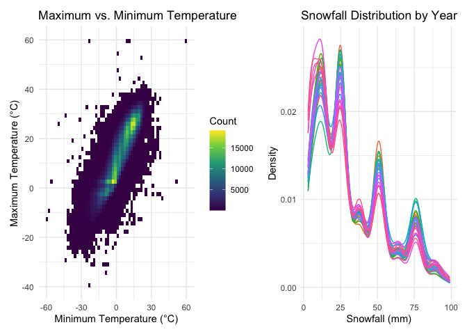
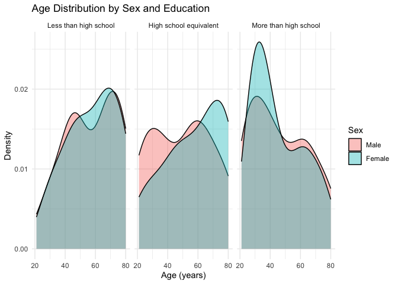
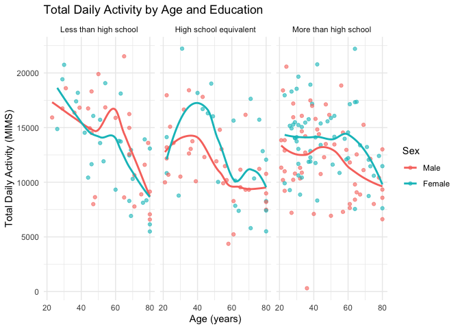
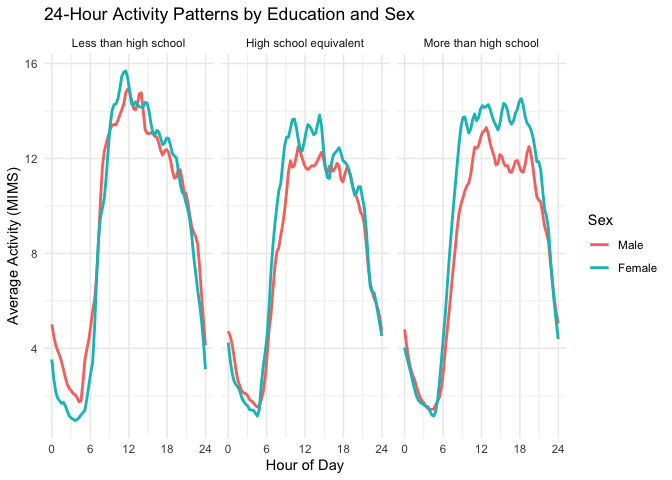
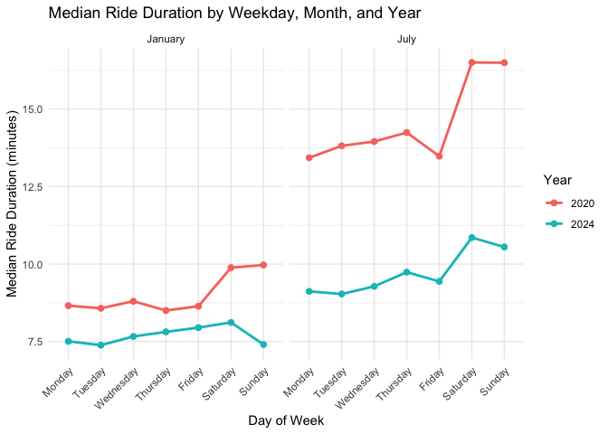
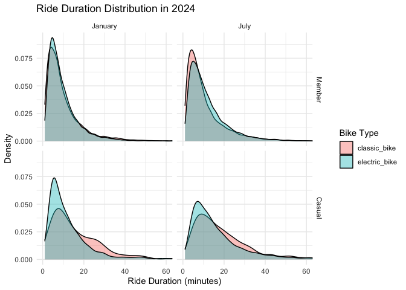

P8105 Homework 3
================
Your Name

# Problem 1

``` r
data("ny_noaa")

head(ny_noaa)
```

    ## # A tibble: 6 × 7
    ##   id          date        prcp  snow  snwd tmax  tmin 
    ##   <chr>       <date>     <int> <int> <int> <chr> <chr>
    ## 1 US1NYAB0001 2007-11-01    NA    NA    NA <NA>  <NA> 
    ## 2 US1NYAB0001 2007-11-02    NA    NA    NA <NA>  <NA> 
    ## 3 US1NYAB0001 2007-11-03    NA    NA    NA <NA>  <NA> 
    ## 4 US1NYAB0001 2007-11-04    NA    NA    NA <NA>  <NA> 
    ## 5 US1NYAB0001 2007-11-05    NA    NA    NA <NA>  <NA> 
    ## 6 US1NYAB0001 2007-11-06    NA    NA    NA <NA>  <NA>

``` r
dim(ny_noaa)
```

    ## [1] 2595176       7

``` r
str(ny_noaa)
```

    ## tibble [2,595,176 × 7] (S3: tbl_df/tbl/data.frame)
    ##  $ id  : chr [1:2595176] "US1NYAB0001" "US1NYAB0001" "US1NYAB0001" "US1NYAB0001" ...
    ##  $ date: Date[1:2595176], format: "2007-11-01" "2007-11-02" ...
    ##  $ prcp: int [1:2595176] NA NA NA NA NA NA NA NA NA NA ...
    ##  $ snow: int [1:2595176] NA NA NA NA NA NA NA NA NA NA ...
    ##  $ snwd: int [1:2595176] NA NA NA NA NA NA NA NA NA NA ...
    ##  $ tmax: chr [1:2595176] NA NA NA NA ...
    ##  $ tmin: chr [1:2595176] NA NA NA NA ...
    ##  - attr(*, "spec")=
    ##   .. cols(
    ##   ..   id = col_character(),
    ##   ..   date = col_date(format = ""),
    ##   ..   prcp = col_integer(),
    ##   ..   snow = col_integer(),
    ##   ..   snwd = col_integer(),
    ##   ..   tmax = col_character(),
    ##   ..   tmin = col_character()
    ##   .. )

``` r
noaa_clean = ny_noaa |>
  mutate(
    year = year(date),
    month = month(date),
    day = day(date),
    tmax = as.numeric(tmax) / 10,
    tmin = as.numeric(tmin) / 10,
    prcp = prcp / 10
  )

head(noaa_clean)
```

    ## # A tibble: 6 × 10
    ##   id          date        prcp  snow  snwd  tmax  tmin  year month   day
    ##   <chr>       <date>     <dbl> <int> <int> <dbl> <dbl> <dbl> <dbl> <int>
    ## 1 US1NYAB0001 2007-11-01    NA    NA    NA    NA    NA  2007    11     1
    ## 2 US1NYAB0001 2007-11-02    NA    NA    NA    NA    NA  2007    11     2
    ## 3 US1NYAB0001 2007-11-03    NA    NA    NA    NA    NA  2007    11     3
    ## 4 US1NYAB0001 2007-11-04    NA    NA    NA    NA    NA  2007    11     4
    ## 5 US1NYAB0001 2007-11-05    NA    NA    NA    NA    NA  2007    11     5
    ## 6 US1NYAB0001 2007-11-06    NA    NA    NA    NA    NA  2007    11     6

``` r
noaa_clean |>
  summarise(
    across(
      everything(),
      ~ sum(is.na(.x))
    )
  )
```

    ## # A tibble: 1 × 10
    ##      id  date   prcp   snow   snwd    tmax    tmin  year month   day
    ##   <int> <int>  <int>  <int>  <int>   <int>   <int> <int> <int> <int>
    ## 1     0     0 145838 381221 591786 1134358 1134420     0     0     0

``` r
noaa_clean |>
  count(snow, sort = TRUE) |>
  head(10)
```

    ## # A tibble: 10 × 2
    ##     snow       n
    ##    <int>   <int>
    ##  1     0 2008508
    ##  2    NA  381221
    ##  3    25   31022
    ##  4    13   23095
    ##  5    51   18274
    ##  6    76   10173
    ##  7     8    9962
    ##  8     5    9748
    ##  9    38    9197
    ## 10     3    8790

### NOAA Data Description

The NOAA dataset contains 2,595,176 observations and 7 original
variables, including station ID, date, precipitation, snowfall, snow
depth, and maximum and minimum temperatures.

The data were cleaned by separating the date into year, month, and day,
converting temperatures to degrees Celsius, and converting precipitation
to millimeters.

Missing data are common, especially for maximum and minimum
temperatures, each with over 1.13 million missing observations.

The most common snowfall value is 0 mm (2,008,508 observations),
followed by missing values (381,221). This is expected because most days
have no snowfall, and some weather stations do not report snowfall
measurements.

``` r
jan_jul_temp = noaa_clean |>
  filter(month %in% c(1, 7)) |>
  group_by(id, year, month) |>
  summarise(
    mean_tmax = mean(tmax, na.rm = TRUE),
    .groups = "drop"
  ) |>
  filter(is.finite(mean_tmax)) |>
  mutate(
    month = factor(
      month,
      levels = c(1, 7),
      labels = c("January", "July")
    )
  )

ggplot(
  jan_jul_temp,
  aes(x = year, y = mean_tmax, group = id)
) +
  geom_point(alpha = 0.15, size = 0.5) +
  facet_grid(. ~ month) +
  labs(
    title = "Average Maximum Temperature in NY",
    x = "Year",
    y = "Average Maximum Temperature (°C)"
  ) +
  theme_minimal()
```

<!-- -->
January temperatures are much lower and more variable than July
temperatures. January averages range mostly from -10°C to 10°C, while
July averages are generally between 20°C and 33°C. There are some
unusually low values in both months, but no clear long-term warming or
cooling trend is visible from this plot.

``` r
# Temperature relationship
temp_plot = noaa_clean |>
  filter(!is.na(tmax), !is.na(tmin)) |>
  ggplot(aes(x = tmin, y = tmax)) +
  geom_bin2d(bins = 60) +
  scale_fill_viridis_c() +
  labs(
    title = "Maximum vs. Minimum Temperature",
    x = "Minimum Temperature (°C)",
    y = "Maximum Temperature (°C)",
    fill = "Count"
  ) +
  theme_minimal()

# Snowfall distribution by year
snow_plot = noaa_clean |>
  filter(snow > 0, snow < 100) |>
  ggplot(aes(x = snow, group = year)) +
  geom_density(aes(color = factor(year)), alpha = 0.5) +
  labs(
    title = "Snowfall Distribution by Year",
    x = "Snowfall (mm)",
    y = "Density",
    color = "Year"
  ) +
  theme_minimal()

temp_plot
```

<!-- -->

``` r
snow_plot
```

<!-- -->

``` r
library(patchwork)

snow_plot = snow_plot +
  theme(legend.position = "none")

combined_plot = temp_plot + snow_plot +
  plot_layout(ncol = 2)

combined_plot
```

<!-- -->
Maximum and minimum temperatures show a strong positive relationship, as
warmer days generally have higher minimum temperatures.

``` r
nhanes_covar = read_csv(
  "data/nhanes_covar.csv",
  skip = 4
)

nhanes_accel = read_csv(
  "data/nhanes_accel.csv"
)

head(nhanes_covar)
```

    ## # A tibble: 6 × 5
    ##    SEQN   sex   age   BMI education
    ##   <dbl> <dbl> <dbl> <dbl>     <dbl>
    ## 1 62161     1    22  23.3         2
    ## 2 62164     2    44  23.2         3
    ## 3 62169     1    21  20.1         2
    ## 4 62174     1    80  33.9         3
    ## 5 62177     1    51  20.1         2
    ## 6 62178     1    80  28.5         2

``` r
head(nhanes_accel)
```

    ## # A tibble: 6 × 1,441
    ##    SEQN  min1  min2  min3  min4   min5   min6  min7   min8    min9  min10  min11
    ##   <dbl> <dbl> <dbl> <dbl> <dbl>  <dbl>  <dbl> <dbl>  <dbl>   <dbl>  <dbl>  <dbl>
    ## 1 62161 1.11  3.12  1.47  0.938 1.60   0.145  2.10  0.509   1.63   1.20   0.947 
    ## 2 62164 1.92  1.67  2.38  0.935 2.59   5.22   2.39  4.90    1.97   3.13   2.77  
    ## 3 62169 5.85  5.18  4.76  6.48  6.85   7.24   6.12  7.48    5.47   6.49   5.14  
    ## 4 62174 5.42  3.48  3.72  3.81  6.85   4.45   0.561 1.61    0.698  2.72   4.85  
    ## 5 62177 6.14  8.06  9.99  6.60  4.57   2.78   7.10  7.25   10.1    7.49   2.72  
    ## 6 62178 0.167 0.429 0.131 1.20  0.0796 0.0487 0.106 0.0653  0.0564 0.0639 0.0909
    ## # ℹ 1,429 more variables: min12 <dbl>, min13 <dbl>, min14 <dbl>, min15 <dbl>,
    ## #   min16 <dbl>, min17 <dbl>, min18 <dbl>, min19 <dbl>, min20 <dbl>,
    ## #   min21 <dbl>, min22 <dbl>, min23 <dbl>, min24 <dbl>, min25 <dbl>,
    ## #   min26 <dbl>, min27 <dbl>, min28 <dbl>, min29 <dbl>, min30 <dbl>,
    ## #   min31 <dbl>, min32 <dbl>, min33 <dbl>, min34 <dbl>, min35 <dbl>,
    ## #   min36 <dbl>, min37 <dbl>, min38 <dbl>, min39 <dbl>, min40 <dbl>,
    ## #   min41 <dbl>, min42 <dbl>, min43 <dbl>, min44 <dbl>, min45 <dbl>, …

``` r
dim(nhanes_covar)
```

    ## [1] 250   5

``` r
dim(nhanes_accel)
```

    ## [1]  250 1441

``` r
nhanes_covar_clean = nhanes_covar |>
  janitor::clean_names() |>
  filter(age >= 21) |>
  drop_na() |>
  mutate(
    sex = factor(
      sex,
      levels = c(1, 2),
      labels = c("Male", "Female")
    ),
    education = factor(
      education,
      levels = c(1, 2, 3),
      labels = c(
        "Less than high school",
        "High school equivalent",
        "More than high school"
      )
    )
  )


nhanes_accel_long = nhanes_accel |>
  janitor::clean_names() |>
  pivot_longer(
    cols = starts_with("min"),
    names_to = "minute",
    values_to = "mims"
  ) |>
  mutate(
    minute = as.numeric(str_remove(minute, "min"))
  )

nhanes_merged = nhanes_accel_long |>
  inner_join(nhanes_covar_clean, by = "seqn")

dim(nhanes_merged)
```

    ## [1] 328320      7

``` r
head(nhanes_merged)
```

    ## # A tibble: 6 × 7
    ##    seqn minute  mims sex     age   bmi education             
    ##   <dbl>  <dbl> <dbl> <fct> <dbl> <dbl> <fct>                 
    ## 1 62161      1 1.11  Male     22  23.3 High school equivalent
    ## 2 62161      2 3.12  Male     22  23.3 High school equivalent
    ## 3 62161      3 1.47  Male     22  23.3 High school equivalent
    ## 4 62161      4 0.938 Male     22  23.3 High school equivalent
    ## 5 62161      5 1.60  Male     22  23.3 High school equivalent
    ## 6 62161      6 0.145 Male     22  23.3 High school equivalent

``` r
demographic_table = nhanes_merged |>
  distinct(seqn, sex, education) |>
  count(education, sex) |>
  pivot_wider(
    names_from = sex,
    values_from = n,
    values_fill = 0
  )

knitr::kable(
  demographic_table,
  caption = "Number of Participants by Sex and Education"
)
```

| education              | Male | Female |
|:-----------------------|-----:|-------:|
| Less than high school  |   27 |     28 |
| High school equivalent |   35 |     23 |
| More than high school  |   56 |     59 |

Number of Participants by Sex and Education

``` r
nhanes_merged |>
  distinct(seqn, sex, age, education) |>
  ggplot(aes(x = age, fill = sex)) +
  geom_density(alpha = 0.4) +
  facet_wrap(~ education) +
  labs(
    title = "Age Distribution by Sex and Education",
    x = "Age (years)",
    y = "Density",
    fill = "Sex"
  ) +
  theme_minimal()
```

<!-- -->
The sample includes 228 participants, with 118 men and 110 women. Most
participants have more than a high school education (115 participants).

Age distributions differ across education levels. Participants with more
than a high school education tend to be younger, while those with less
education generally include more older adults. Some differences between
men and women are also visible.

``` r
daily_activity = nhanes_merged |>
  group_by(seqn, sex, age, bmi, education) |>
  summarise(
    total_activity = sum(mims, na.rm = TRUE),
    .groups = "drop"
  )

ggplot(
  daily_activity,
  aes(x = age, y = total_activity, color = sex)
) +
  geom_point(alpha = 0.6) +
  geom_smooth(method = "loess", se = FALSE) +
  facet_wrap(~ education) +
  labs(
    title = "Total Daily Activity by Age and Education",
    x = "Age (years)",
    y = "Total Daily Activity (MIMS)",
    color = "Sex"
  ) +
  theme_minimal()
```

<!-- -->
Total daily activity generally decreases with age across all education
levels. Women tend to have higher activity levels than men in the high
school and higher education groups, although the differences vary by
age. Individual activity levels also show considerable variation.

``` r
hourly_activity = nhanes_merged |>
  mutate(
    hour = (minute - 1) / 60
  ) |>
  group_by(education, sex, hour) |>
  summarise(
    mean_activity = mean(mims, na.rm = TRUE),
    .groups = "drop"
  )

ggplot(
  hourly_activity,
  aes(x = hour, y = mean_activity, color = sex)
) +
  geom_smooth(
    method = "loess",
    se = FALSE,
    span = 0.08
  ) +
  facet_wrap(~ education) +
  scale_x_continuous(
    breaks = seq(0, 24, 6),
    limits = c(0, 24)
  ) +
  labs(
    title = "24-Hour Activity Patterns by Education and Sex",
    x = "Hour of Day",
    y = "Average Activity (MIMS)",
    color = "Sex"
  ) +
  theme_minimal()
```

<!-- -->
Activity levels are lowest during the early morning hours and increase
sharply after 6 AM. Activity remains relatively high throughout the day
before decreasing in the evening. Women generally show higher activity
levels than men, especially in the higher education groups. Overall,
daily activity patterns are similar across education levels, although
the timing and intensity of activity vary.

# Problem 3

``` r
citibike_2020_jan = read_csv("data/Jan 2020 Citi.csv")
citibike_2020_jul = read_csv("data/July 2020 Citi.csv")
citibike_2024_jan = read_csv("data/Jan 2024 Citi.csv")
citibike_2024_jul = read_csv("data/July 2024 Citi.csv")

dim(citibike_2020_jan)
```

    ## [1] 12420     7

``` r
dim(citibike_2020_jul)
```

    ## [1] 21048     7

``` r
dim(citibike_2024_jan)
```

    ## [1] 18861     7

``` r
dim(citibike_2024_jul)
```

    ## [1] 47156     7

``` r
names(citibike_2020_jan)
```

    ## [1] "ride_id"            "rideable_type"      "weekdays"          
    ## [4] "duration"           "start_station_name" "end_station_name"  
    ## [7] "member_casual"

``` r
names(citibike_2024_jan)
```

    ## [1] "ride_id"            "rideable_type"      "weekdays"          
    ## [4] "duration"           "start_station_name" "end_station_name"  
    ## [7] "member_casual"

``` r
citibike = bind_rows(
  citibike_2020_jan |> mutate(year = 2020, month = "January"),
  citibike_2020_jul |> mutate(year = 2020, month = "July"),
  citibike_2024_jan |> mutate(year = 2024, month = "January"),
  citibike_2024_jul |> mutate(year = 2024, month = "July")
) |>
  mutate(
    year = factor(year, levels = c(2020, 2024)),
    month = factor(month, levels = c("January", "July")),
    member_casual = factor(
      member_casual,
      levels = c("member", "casual"),
      labels = c("Member", "Casual")
    ),
    rideable_type = factor(rideable_type)
  ) |>
  distinct(ride_id, .keep_all = TRUE)

dim(citibike)
```

    ## [1] 99485     9

``` r
head(citibike)
```

    ## # A tibble: 6 × 9
    ##   ride_id    rideable_type weekdays duration start_station_name end_station_name
    ##   <chr>      <fct>         <chr>       <dbl> <chr>              <chr>           
    ## 1 4BE06CB33… classic_bike  Tuesday     15.3  Columbus Ave & W … E 53 St & Madis…
    ## 2 26886E034… classic_bike  Wednesd…     5.31 2 Ave & E 96 St    1 Ave & E 110 St
    ## 3 24DC56060… classic_bike  Friday       9.69 Columbia St & Riv… Grand St & Eliz…
    ## 4 EEDC10535… classic_bike  Sunday       7.00 W 84 St & Columbu… Columbus Ave & …
    ## 5 2CD4BD4CE… classic_bike  Friday       2.85 Forsyth St & Broo… Suffolk St & St…
    ## 6 E18682F9A… classic_bike  Sunday      25.5  Allen St & Hester… Atlantic Ave & …
    ## # ℹ 3 more variables: member_casual <fct>, year <fct>, month <fct>

``` r
summary(citibike$duration)
```

    ##    Min. 1st Qu.  Median    Mean 3rd Qu.    Max. 
    ##   1.002   5.595   9.839  13.930  17.560 238.780

The cleaned Citi Bike dataset contains 99,485 rides from January and
July of 2020 and 2024. It includes ride duration, bike type, membership
status, weekday, and starting and ending stations. The median ride
duration is 9.84 minutes, while the mean is 13.93 minutes, indicating a
right-skewed distribution.

``` r
ride_counts = citibike |>
  count(year, month, member_casual) |>
  pivot_wider(
    names_from = member_casual,
    values_from = n,
    values_fill = 0
  ) |>
  arrange(year, month)

knitr::kable(
  ride_counts,
  caption = "Number of Citi Bike Rides by Year, Month, and Membership"
)
```

| year | month   | Member | Casual |
|:-----|:--------|-------:|-------:|
| 2020 | January |  11436 |    984 |
| 2020 | July    |  15411 |   5637 |
| 2024 | January |  16753 |   2108 |
| 2024 | July    |  36262 |  10894 |

Number of Citi Bike Rides by Year, Month, and Membership

Citi Bike members took more rides than casual users in every month. July
had substantially more rides than January in both years. The number of
rides also increased from 2020 to 2024, especially in July. These
results suggest seasonal differences and growth in Citi Bike usage,
although the data represent only a 1% sample.

``` r
top_stations = citibike |>
  filter(year == "2024", month == "July") |>
  filter(!is.na(start_station_name)) |>
  count(start_station_name, name = "rides") |>
  arrange(desc(rides)) |>
  slice_head(n = 5)

knitr::kable(
  top_stations,
  col.names = c("Starting Station", "Number of Rides"),
  caption = "Top 5 Starting Stations in July 2024"
)
```

| Starting Station         | Number of Rides |
|:-------------------------|----------------:|
| Pier 61 at Chelsea Piers |             163 |
| University Pl & E 14 St  |             155 |
| W 21 St & 6 Ave          |             152 |
| West St & Chambers St    |             150 |
| W 31 St & 7 Ave          |             146 |

Top 5 Starting Stations in July 2024

In July 2024, Pier 61 at Chelsea Piers was the most popular starting
station, with 163 rides, followed by University Pl & E 14 St with 155
rides. The five most popular stations had similar ride counts, ranging
from 146 to 163 in the sampled data.

``` r
median_rides = citibike |>
  mutate(
    weekdays = factor(
      weekdays,
      levels = c(
        "Monday", "Tuesday", "Wednesday",
        "Thursday", "Friday", "Saturday", "Sunday"
      )
    )
  ) |>
  group_by(year, month, weekdays) |>
  summarise(
    median_duration = median(duration, na.rm = TRUE),
    .groups = "drop"
  )

ggplot(
  median_rides,
  aes(
    x = weekdays,
    y = median_duration,
    color = year,
    group = year
  )
) +
  geom_line(linewidth = 1) +
  geom_point(size = 2) +
  facet_wrap(~ month) +
  labs(
    title = "Median Ride Duration by Weekday, Month, and Year",
    x = "Day of Week",
    y = "Median Ride Duration (minutes)",
    color = "Year"
  ) +
  theme_minimal() +
  theme(
    axis.text.x = element_text(angle = 45, hjust = 1)
  )
```

<!-- -->
Median ride durations were longer in July than in January and were
consistently higher in 2020 than in 2024. Weekend rides, especially in
July, tended to last longer than weekday rides. This suggests seasonal
and weekly differences in riding behavior.

``` r
citibike |>
  filter(year == "2024") |>
  ggplot(
    aes(
      x = duration,
      fill = rideable_type
    )
  ) +
  geom_density(alpha = 0.4) +
  facet_grid(member_casual ~ month) +
  coord_cartesian(xlim = c(0, 60)) +
  labs(
    title = "Ride Duration Distribution in 2024",
    x = "Ride Duration (minutes)",
    y = "Density",
    fill = "Bike Type"
  ) +
  theme_minimal()
```

<!-- -->
Ride durations are right-skewed across all groups, with most rides
lasting less than 20 minutes. Casual riders tend to take longer rides
than members. Electric bike rides are generally shorter than classic
bike rides, especially among casual riders. The differences between
January and July are relatively small compared with those between
membership groups.
